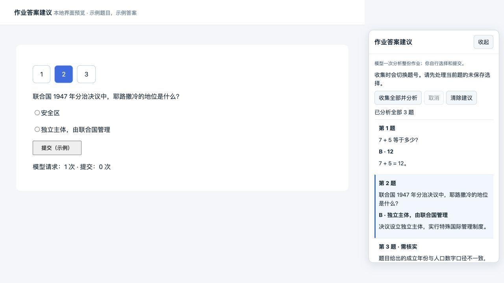

# 雨课堂视频队列与作业答案建议

独立 Chrome MV3 扩展：静音视频队列，以及整份作业的模型答案建议。仅适配 `pro.yuketang.cn`，不支持其他雨课堂域名。当前版本 **0.2.0，实验版**。

视频队列无需模型服务；AI 建议需要本机 Node.js 22 和你自己的模型 API key，费用由所配置的提供商收取。视觉模式可跨平台使用，OCR 仅支持 macOS。

[下载最新版本](https://github.com/Daucloud/yuketang-rush/releases/latest) · [MIT 许可证](LICENSE) · [参与开发](CONTRIBUTING.md)



上图使用示例题与模拟答案，不包含真实课程或账户信息。

## 当前行为

- 读取学习日志或 AI 学习空间目录，默认仅选择未完成视频。
- 1–4 个课程窗口，持续静音、真实播放，默认不抢焦点。视频播放结束后回查目录，平台明确显示已完成才进入下一项。
- 作业独立于视频队列：右侧显示「作业答案建议」，由用户自行选择与提交。自动选择和提交的旧消息接口已禁用，旧配置中的 `autoQA` 也不会恢复自动提交。
- 点一次「收集全部并分析」，先读取整份题面，再通过一次模型请求分析全部题目；模型不再逐题调用。结果按题号显示，切题只更新侧栏高亮。
- 收集通过正常题号导航完成，不读取隐藏答案或直接调用平台作答接口。页面只渲染当前题，所以收集题面仍需要依次切换题号。收齐后回到原题。
- 已提交的题目也可收集用于复习。当前题存在未提交选择、安全核验或未保存答案提示时，停止收集；不会清除选择、确认弹窗或提交。
- 题干及选项按页面实际字体渲染为图片，避免字体混淆造成乱码。官方 DeepSeek Flash 默认直接读取图片；其他模型可使用本机 OCR。
- 建议包含题干明文、选项、推荐答案与依据。不确定或口径冲突的题目显示「需核实」，不推荐猜测。
- 相同题面使用本地缓存；缓存仅保留最近 10 份作业的文字建议、时间与指纹，不保存图片。重新打开时会标注上次分析时间；题面变化后应重新收集。

## 更新已有安装

1. 在 Chrome 或 Chrome for Testing 的扩展管理页，重新加载「雨课堂 · 平铺学习助手」。
2. 刷新课程页面，让新的侧栏和视频逻辑生效。不要只刷新旧控制页。
3. 打开控制页，填写 `.env` 中的 `BRIDGE_TOKEN` 并检查本地服务。扩展重载后可能需要重新填写连接口令。
4. 读取课程目录，选择视频，再开始队列。作业请单独打开，使用右侧「收集全部并分析」。

源码更新不会自动替换已经运行的内容脚本。新侧栏出现、旧自动答题开关消失后，才表明浏览器加载了新版。

## 首次安装

1. 从 [Releases](https://github.com/Daucloud/yuketang-rush/releases/latest) 下载 `yuketang-extension-0.2.0.zip`，解压到固定文件夹。
2. 在你的 Chrome 打开 `chrome://extensions`，开启「开发者模式」。
3. 点击「加载已解压的扩展程序」，选择解压后的 `extension` 文件夹。
4. 登录课程并刷新页面，点击扩展图标打开控制页，读取目录、选择视频并启动队列。
5. 如需作业建议，再按下节配置模型服务，在控制页保存连接口令，然后打开作业侧栏。

普通 Chrome 即可使用，无需安装 Chrome for Testing。源码包也包含 `extension` 文件夹；可直接加载。`scripts/open-chrome.sh` 仅是 macOS 开发辅助脚本，不是安装步骤。

从目录打开单元时，助手拦截受管课程弹窗并在原标签页导航。若无法完成握手，队列停止，不会不断打开新窗口。默认不置前；「重新平铺」仍会主动调整并置前窗口。

## 本地模型服务

下载并解压完整源码包，进入项目目录。需要 Node.js 22 或更高版本，正常运行无需第三方 npm 包。

```sh
cp .env.example .env
```

在 `.env` 配置：

```dotenv
LLM_BASE_URL=https://your-provider.example/v1
LLM_MODEL=your-model-name
LLM_API_KEY=your-api-key
BRIDGE_TOKEN=至少24字符的随机连接口令
```

接口基地址不包括 `/chat/completions`，是否带 `/v1` 以提供商为准。

```sh
npm start
```

服务仅监听 `127.0.0.1:8765`。连接口令只存于扩展会话存储，API key 只由本机 Node 进程读取。视觉模式会将题干与选项的渲染图片发送给配置的模型；OCR 模式只向模型发送识别文字。

官方 `api.deepseek.com` 的 `deepseek-flash` 默认启用视觉，也可设置 `LLM_VISION=true` 或 `false`。OCR 模式需要 macOS 与 Swift 编译工具：

```sh
npm run build:ocr
```

新批量接口为 `POST /qa/batch`，支持一次 1–100 题，整个请求上限 32 MB。最多并行两个分析请求；模型请求最长 120 秒，扩展最长 150 秒。模型返回题号缺失、重复、未知选项或缺少视觉题的转写内容时，整批失败，不显示错配或不完整答案。

## 暂停、缓存与边界

- 「暂停全部 / 继续队列」控制视频播放；作业建议有独立的「取消」按钮，不依赖视频队列是否暂停。
- 「清除建议」取消进行中的分析并删除当前作业建议，不修改平台上的答案。
- 题面中的插图、填空、简答和无法识别的题型目前会使整份收集停止。纯文字题渲染成图片用于读取字体，不等同于支持所有图片题。
- 切题时遇到核验就停止；批量分析不保证避免平台核验。
- 若浏览器阻止自动播放、锁屏、媒体加载失败、后台冻结或平台不计入时长，需要处理后重试。不会伪造时间、可见性、焦点或完成记录。
- 只有带目录定位信息的任务能自动回查并切到下一视频；单独粘贴的视频链接结束后需要手动确认。
- 不读取 Cookie、不写入平台学习时长或成绩接口。模型建议可能错误，应核对课程资料后作答。

## 开发验证

```sh
npm ci
npm run check
npm test
```

本地测试覆盖视频队列、静音与窗口焦点、整批单次请求、题号与选项映射、缓存、取消、核验停止和不选择不提交。界面示例可运行：

```sh
node scripts/preview-advice.mjs
```

预览地址：`http://127.0.0.1:8767/v2/web/iframe-exercise/1/1`。仅使用示例答案，不连接课程或模型。当前通过 44 项本地自动化测试、模拟界面验证及一次真实模型的示例题批量调用。新版自动视频队列尚未完成真实课程端到端验证，不能保证所有页面与后台播放环境均可运行。详见 [更新记录](CHANGELOG.md)。
